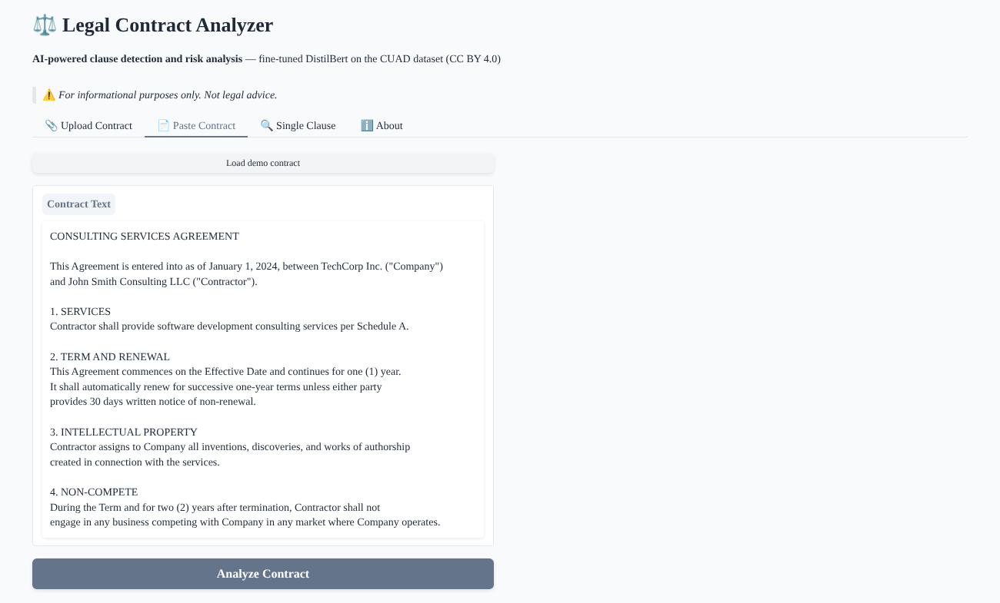
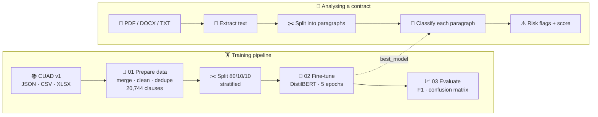
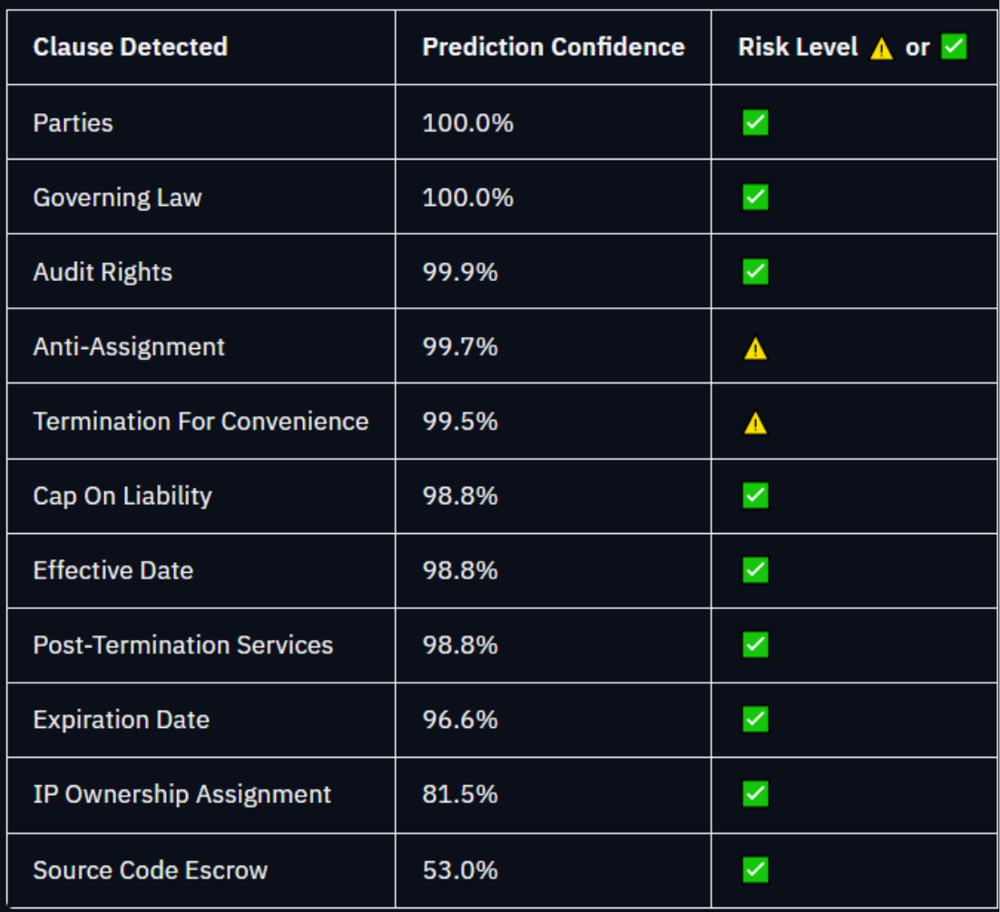
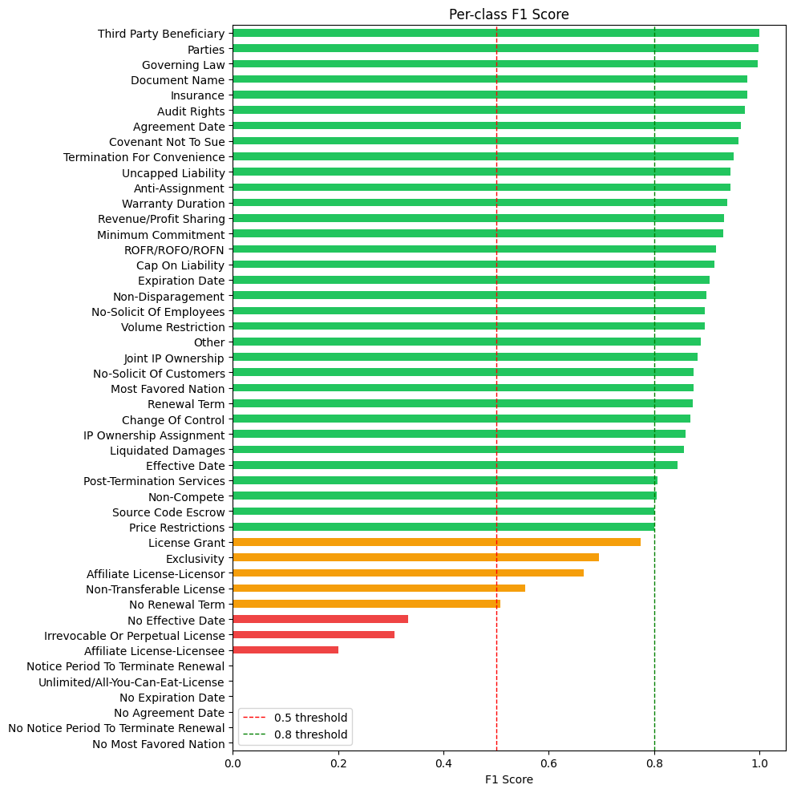
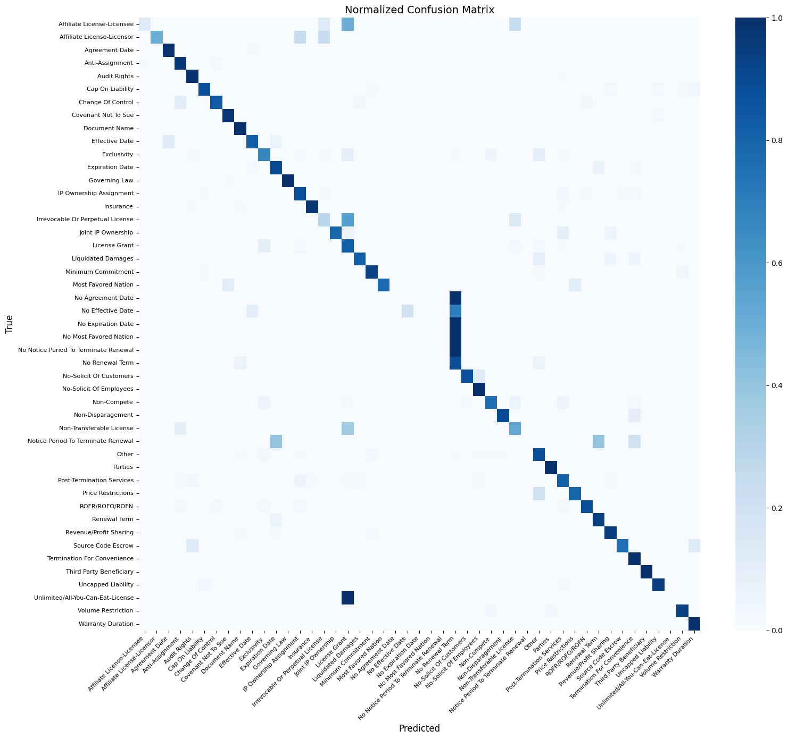
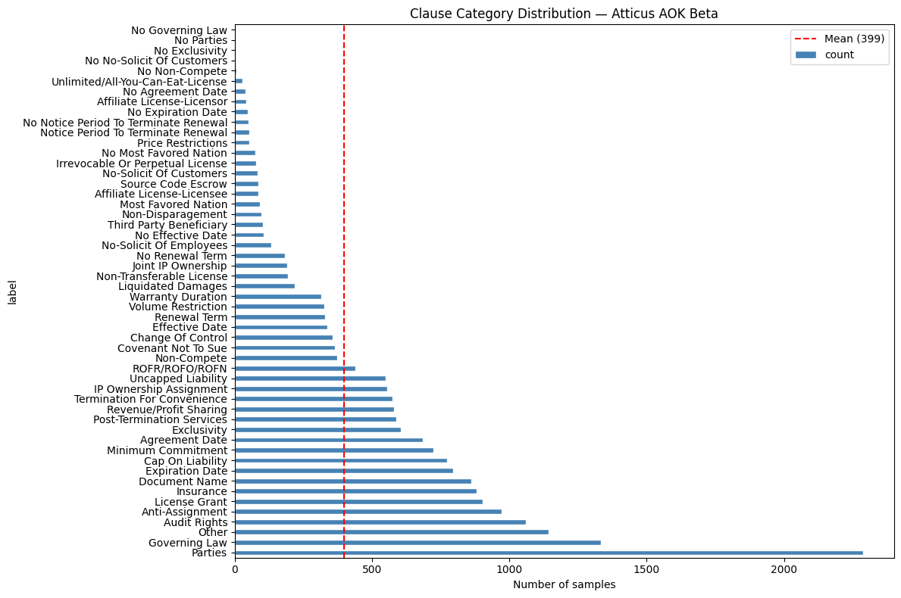
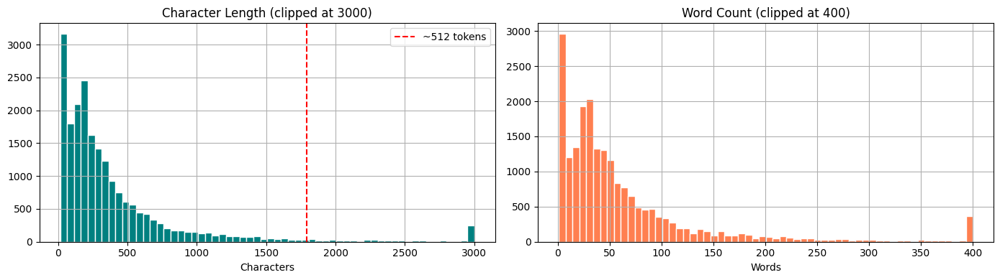

<div align="center">

# ⚖️ Legal Contract Analysis AI

### Automatic clause detection and risk flagging for legal contracts with a fine-tuned transformer

Upload a contract (PDF, DOCX or TXT) and the model finds clauses such as **Governing Law**, **Non-Compete**, **Uncapped Liability** or **IP Ownership**, rates its confidence and flags risky clauses, with an overall risk score.


<br>

| Test accuracy | Macro F1 | Clause classes | Training samples | Training time |
|:---:|:---:|:---:|:---:|:---:|
| **89.8 %** | **0.72** | **48** | **16,595** | **~20 min** (RTX 3060 Laptop) |

</div>

---

## 📑 Contents

- [The Problem](#-the-problem)
- [Features](#-features)
- [How It Works](#%EF%B8%8F-how-it-works)
- [Results](#-results)
- [Getting Started](#-getting-started)
- [Usage](#-usage)
- [Project Structure](#-project-structure)
- [Limitations](#%EF%B8%8F-limitations)
- [Dataset & License](#-dataset--license)

---

## 💡 The Problem

Legal contracts are long and dense. Critical clauses about **liability, termination, intellectual property, non-compete or dispute resolution** are easy to miss, and manual review is slow, expensive and inconsistent.

This project fine-tunes **DistilBERT** on the **CUAD** dataset (13,000+ expert-labelled clauses from 510 real commercial contracts) to automatically recognise contract clauses and highlight the ones that need a closer look.

---

## ✨ Features

| | Feature | Details |
|---|---|---|
| 📄 | **Many input formats** | PDF, DOCX, TXT and Markdown files, or pasted text |
| 🔍 | **Clause classification** | Recognises 48 clause types (present and absent clause classes) |
| ⚠️ | **Risk flags** | Highlights risky clauses: Uncapped Liability, Liquidated Damages, Non-Compete, Anti-Assignment, Change of Control, No-Solicit and Termination for Convenience |
| 📊 | **Risk score** | Overall contract risk score from 0 to 100 |
| 🎯 | **Confidence scores** | Top-5 predictions with probabilities for every clause |
| 💬 | **Plain-English explanations** | Short description of what each detected clause means |
| 🖥️ | **Web UI + CLI** | Gradio app with 4 tabs, plus a command-line tool |
| 📤 | **JSON export** | Machine-readable results for further processing |

<p align="center">
  
</p>

---

## ⚙️ How It Works



### 1. Data preparation ([`01_prepare_data.ipynb`](notebooks/01_prepare_data.ipynb))

CUAD provides its annotations in three different formats, so all three are merged:

| Source | Rows |
|---|---|
| `CUAD_v1.json`: SQuAD-style QA annotations (clauses present and absent) | 26,462 |
| `master_clauses.csv`: one column per clause type, melted into long format | 40,610 |
| `label_group_xlsx/`: 28 Excel label reports | 4,063 |
| **After cleaning, label normalisation and deduplication** | **20,744** |

Labels are mapped onto the official 41 CUAD categories, plus "No …" classes for clauses that are absent.

### 2. Fine-tuning ([`02_finetune.ipynb`](notebooks/02_finetune.ipynb))

| Setting | Value |
|---|---|
| Base model | `distilbert-base-uncased` (67 M parameters, full fine-tuning) |
| Max sequence length | 512 tokens |
| Split | 16,595 train / 2,074 validation / 2,075 test (stratified) |
| Epochs | 5 |
| Batch size | 8 × 2 gradient accumulation = 16 effective |
| Precision | fp16 on GPU |
| Best model selected by | Macro F1 on validation set |

Very rare classes (fewer than 4 examples) are merged into an `Other` class so the stratified split stays valid. Other base models (Legal-BERT, DeBERTa-v3) can be selected in [`config.yaml`](config.yaml).

### 3. Contract analysis ([`scripts/inference.py`](scripts/inference.py))

The contract is split into paragraphs, and each paragraph is classified. Predictions above the confidence threshold (0.5) count as detected clauses. Each risky clause adds 15 points to the risk score, capped at 100.

---

## 📊 Results

Evaluated on the held-out test set of **2,075 clauses** ([`03_evaluate.ipynb`](notebooks/03_evaluate.ipynb)):

| Metric | Score |
|---|---|
| Accuracy | **89.8 %** |
| Macro F1 | **0.72** |
| Weighted F1 | **0.89** |

**Strongest classes (F1 ≥ 0.95):** Parties, Governing Law, Third Party Beneficiary, Insurance, Audit Rights, Agreement Date, Uncapped Liability, Termination for Convenience

**Example analysis of a full contract:**

<p align="center">
  
</p>

<details>
<summary><b>📈 Per-class F1 score</b></summary>
<br>

</details>

<details>
<summary><b>🔲 Confusion matrix</b></summary>
<br>


The most common confusions are between closely related clauses, e.g. *License Grant ↔ Exclusivity*, *Non-Transferable License ↔ License Grant* and *Effective Date ↔ Agreement Date*.
</details>

<details>
<summary><b>📚 Dataset: label distribution and clause lengths</b></summary>
<br>

<br><br>


The dataset is heavily imbalanced (*Parties*: 2,287 examples vs. some classes with fewer than 10), which explains the gap between accuracy and macro F1. More analysis is in [`04_exploration.ipynb`](notebooks/04_exploration.ipynb).
</details>

---

## 🚀 Getting Started

### Prerequisites

- 🐍 **Python 3.10+** (developed with 3.13)
- ⚡ **[uv](https://docs.astral.sh/uv/)**: install with `pip install uv`
- 🎮 **NVIDIA GPU** recommended for training. Inference also runs on CPU.

### 1️⃣ Clone and install

```bash
git clone https://github.com/Aditya74747/legal-contract-analysis-ai.git
cd legal-contract-analysis-ai
uv sync
```

> PyTorch is installed from the CUDA 12.6 index (see `pyproject.toml`). This works on Windows and Linux.

### 2️⃣ Get the model

- **Download:** get `best_model.zip` from the [Releases page](https://github.com/Aditya74747/legal-contract-analysis-ai/releases/latest) and extract it to `models/finetuned/best_model/`, **or**
- **Train it yourself:** download the dataset (see [`data/README.md`](data/README.md)), then run notebooks `01` and `02`

### 3️⃣ Register the Jupyter kernel (only needed for the notebooks)

```bash
uv run python -m ipykernel install --user --name legal-ai --display-name "Legal AI"
```

---

## 💻 Usage

### Web interface

```bash
uv run python ui/app.py
```

Open **http://localhost:7860**. The app has four tabs:

| Tab | What it does |
|---|---|
| 📎 **Upload Contract** | Upload a PDF / DOCX / TXT and get the full analysis |
| 📄 **Paste Contract** | Paste contract text (a demo contract is built in) |
| 🔍 **Single Clause** | Classify one clause and see its top-5 predictions |
| ℹ️ **About** | Model and dataset information |

### Command line

```bash
# Analyse a whole contract
uv run python scripts/inference.py --file samples/sample_nda.txt

# Classify a single clause
uv run python scripts/inference.py --text "This Agreement shall be governed by the laws of the State of Delaware."

# Interactive mode
uv run python scripts/inference.py --interactive
```

Two sample contracts to try are in [`samples/`](samples): a mutual NDA and a residential lease with several deliberately one-sided clauses.

### In Python

```python
from scripts.inference import LegalContractAnalyzer

analyzer = LegalContractAnalyzer()
result = analyzer.analyze_clause("Contractor shall not compete with the Company for two years.")
print(result["predicted_category"], result["confidence"], result["is_risky"])
```

---

## 📂 Project Structure

```
legal-contract-analysis-ai/
├── config.yaml                 Central configuration: data paths, model presets, training, UI
├── pyproject.toml / uv.lock    Dependencies (managed with uv)
├── notebooks/
│   ├── 01_prepare_data.ipynb   Merge and clean CUAD (JSON + CSV + XLSX)
│   ├── 02_finetune.ipynb       Tokenise and fine-tune DistilBERT
│   ├── 03_evaluate.ipynb       Test metrics, confusion matrix, error analysis
│   └── 04_exploration.ipynb    Exploratory data analysis
├── scripts/
│   └── inference.py            LegalContractAnalyzer, text extraction and CLI
├── ui/
│   └── app.py                  Gradio web interface
├── samples/                    Example contracts for testing
├── data/                       Dataset goes here (not in git, see data/README.md)
├── models/                     Trained model goes here (not in git, see models/README.md)
└── docs/images/                Charts and screenshots
```

---

## ⚠️ Limitations

- **Not legal advice.** This is a review-support tool, and a lawyer should always check its results.
- **Rare classes are weak.** Classes with very few training examples (e.g. *Unlimited License*, some "No …" classes) have low F1.
- **Paragraph-based.** Contracts are split at blank lines, so clauses spread over several paragraphs, or paragraphs with several clauses, can be misclassified.
- **Text-based PDFs only.** Scanned PDFs need OCR first.
- **English only**, and trained on US commercial contracts.

---

## 📄 Dataset & License

- **Code:** [MIT License](LICENSE)
- **Dataset:** [CUAD v1](https://www.atticusprojectai.org/cuad) by The Atticus Project, licensed under [CC BY 4.0](https://creativecommons.org/licenses/by/4.0/). *Hendrycks et al., "CUAD: An Expert-Annotated NLP Dataset for Legal Contract Review", NeurIPS 2021.*
- **Base model:** [`distilbert-base-uncased`](https://huggingface.co/distilbert-base-uncased) (Apache 2.0)
